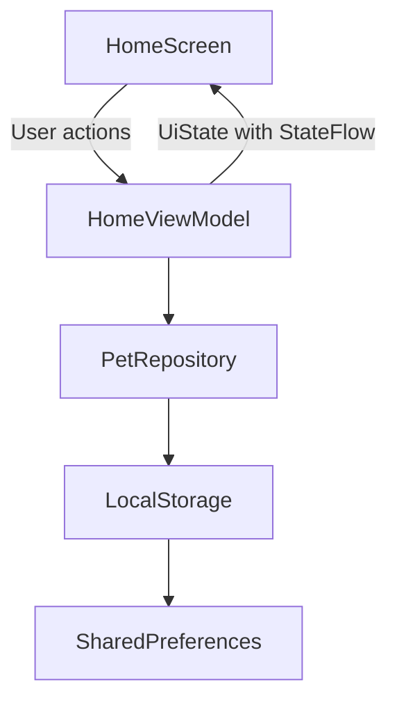

# PawPal SIS4 Architecture

For SIS4, I used MVVM architecture for the home screen of my PawPal app. I separated the UI from the logic and data storage.

## Architecture Diagram

HomeScreen displays the pet list, search bar and filters. HomeViewModel handles searching, filtering, sorting and loading data. PetRepository gets the data from LocalStorage, where pet information is saved on the device.

The main UI state contains the pet list, search text, selected pet type, loading status, error message and sorting order.

For example, when I type "Bella" in the search bar, HomeScreen sends the text to HomeViewModel. The ViewModel filters the pet list and updates UiState. StateFlow sends the new state to the screen, and the matching pets are displayed.

I also added a simulated loading error and a Retry button to test error handling.